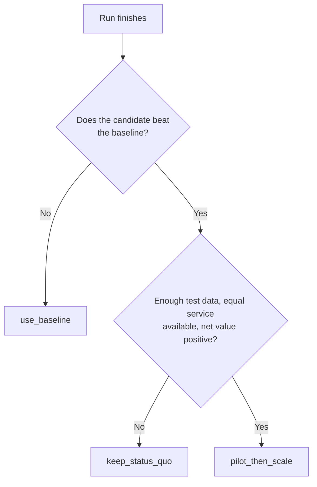
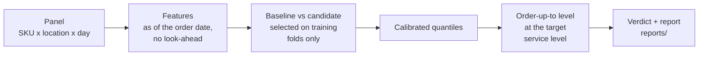

# forecasting-retail-fmcg

**Forecast demand, decide how much to order, and find out honestly whether the model is worth adopting.**

[](#status)
[](LICENSE)
[](#make-targets)
[](#make-targets)

> **In short.** For every SKU x location, the pipeline forecasts demand over one order cycle, turns the forecast into an order-up-to quantity, and tests whether that beats a simple baseline. You get a **verdict you can act on**, not only a forecast.

> [!IMPORTANT]
> **The one rule: the model may lose.** If it does not beat the baseline, the verdict is to keep the baseline. That is a legitimate result, not a failure.

---

## At a glance

| You give | You get | You decide |
|:--|:--|:--|
| A panel of daily sales per SKU and location, plus your cost inputs. | Calibrated forecast quantiles, an order-up-to level per series, and one report with a verdict, reason codes, flags and limitations. | How many units to order up to, per series, per review cycle, and whether to adopt the model at all. |

## Find your way

| I want to... | Go to |
|:--|:--|
| See it run in a few minutes | [Quick start](#quick-start) |
| Understand what the project can do | [Features](#features) |
| Know what a verdict means and what to do next | [The verdict](#the-verdict) |
| Read a report without getting lost | [Reading a report](#reading-a-report) |
| Run it on my own data | [Run on your own data](#run-on-your-own-data) |
| Fix an error | [Troubleshooting](#troubleshooting) |
| Look up a word | [Glossary](#glossary) |

| You are a | Read | Then |
|:--|:--|:--|
| Planner or buyer | [User Guide](docs/user-guide.md) | You can stop here. |
| Analyst | [Methodology](docs/methodology.md) | Back to the User Guide. |
| Developer | [Reference](docs/reference.md) | Dive into `src/fcst/`. |

## Status

The method is shown on **synthetic data only**. No real-data result exists yet.

This README holds **no result figures**, by design. Every run writes its own results to `reports/`, and output from synthetic data is bannered because it says nothing about real sales.

---

## Why this exists

Retail demand without contracts loses money in two ways, and they pull in opposite directions.

| If you order... | You lose... | It shows up as |
|:--|:--|:--|
| **Too little** | Sales you could have made. | Stockout, lost margin. |
| **Too much** | Cash and shelf life. | Tied-up working capital, expiry, markdown. |

This is the classic **newsvendor** problem. The balance point depends on one comparison: how much a missed sale hurts against how much a leftover unit costs. The more a missed sale hurts, the higher the **service level** you should aim for, and the more stock you order up to.

The project takes that comparison from your cost inputs (margin per unit against holding cost plus expected write-off), forecasts demand with calibrated uncertainty, and converts both into an order-up-to level per series.

Then it asks the question most forecasting projects skip: **is any of this better than what you already do?**

---

## Features

| | Feature | In one line |
|:-:|:--|:--|
| ⚖️ | [Honest verdict](#1-an-honest-verdict) | Three outcomes, and "keep the baseline" is one of them. |
| 🥊 | [Fair model contest](#2-a-fair-model-contest) | A simple baseline against a gradient-boosted candidate. |
| 🎯 | [Calibrated quantiles](#3-calibrated-quantiles) | Forecast ranges that are checked, not assumed. |
| 📦 | [Order-up-to policy](#4-order-up-to-policy) | A stock level per series at a service level your costs justify. |
| 🟰 | [Equal-service comparison](#5-equal-service-comparison) | Inventory is compared only at the same stockout rate. |
| 🔒 | [Leakage guards](#6-leakage-guards) | A feature that peeks at the future stops the run. |
| 🌫️ | [Uncertainty on display](#7-uncertainty-on-display) | Intervals and flags say how far to trust a number. |
| 📜 | [Reproducible and auditable](#8-reproducible-and-auditable) | Same seed and inputs, same numbers; hashes on every report. |
| 🧾 | [Strict reporting](#9-strict-reporting) | Numbers come from one file and cannot be typed by hand. |
| 🚧 | [Safe data handling](#10-safe-data-handling) | No silent fallbacks, no stray columns. |

### 1. An honest verdict

- **What it does.** Ends every run with one of three verdicts: `use_baseline`, `keep_status_quo`, or `pilot_then_scale`.
- **Why you care.** You get a decision, not a chart. A model that does not pay is not adopted.
- **Where to see it.** Top of `reports/report.md`, and `decision` in `reports/metrics.json`.

### 2. A fair model contest

- **What it does.** Pits a **baseline** (seasonal naive) against a **candidate** (gradient-boosted model). Cross-validation on training rows picks the winner. Test rows are never read during selection.
- **Why you care.** The candidate has to earn its place against something simple.
- **Where to see it.** Accuracy section of the report.

### 3. Calibrated quantiles

- **What it does.** Adjusts the forecast quantiles on a separate calibration block (conformal scaling), then checks on the test set whether the stated service level holds.
- **Why you care.** If you plan for a given stockout rate, calibration tells you whether you will actually get it.
- **Where to see it.** Calibration section of the report; flag `F_CALIBRATION_OUT_OF_TOLERANCE` when it does not hold.

### 4. Order-up-to policy

- **What it does.** Turns the calibrated quantile at the target service level into the stock level to order up to. The target comes from your cost inputs, not from a rule of thumb.
- **Why you care.** The order quantity is tied to what a lost sale and a leftover unit actually cost you.
- **Where to see it.** `config.yaml` (inputs), report (result).

### 5. Equal-service comparison

- **What it does.** Compares inventory between the model and the baseline **at the same stockout rate**.
- **Why you care.** Holding less stock while missing more sales is not an improvement. This is the only place where the report makes a business claim.
- **Where to see it.** The equal-service block of the report. The stockout versus working-capital table next to it is context, not a comparison.

### 6. Leakage guards

- **What it does.** Computes features as of the order date, splits strictly by time with a purge gap at least as long as the horizon, reads only schema columns, and checks for look-ahead. If a feature peeks at the future, the run stops.
- **Why you care.** Leaked information makes any model look brilliant and fail in production.
- **Where to see it.** The `features` and `split` steps; leakage proof in the metrics.

### 7. Uncertainty on display

- **What it does.** Puts bootstrap intervals on the accuracy difference and the business figures, and raises flags for synthetic data, calibration misses, and intervals that include zero.
- **Why you care.** A difference whose interval includes zero may be noise. Flags never change the verdict; they tell you how far to trust it.
- **Where to see it.** Accuracy and flags sections of the report.

### 8. Reproducible and auditable

- **What it does.** Records data, model and source hashes. The test set is predicted **once**, and every later number comes from that single table. The same seed and inputs give the same `metrics.json`.
- **Why you care.** You can rerun a result, and you can tell when a report is stale.
- **Where to see it.** Report footer (source hash), `artifacts/bundle.json`, `artifacts/test_predictions.csv`.

### 9. Strict reporting

- **What it does.** The report template has no numeric literals and is rendered strictly from `reports/metrics.json`. Documentation carries no hand-typed result figures, and a test enforces that.
- **Why you care.** The report cannot quietly disagree with the run that produced it.
- **Where to see it.** `templates/report.md.j2`, `src/fcst/report.py`.

### 10. Safe data handling

- **What it does.** A missing data file is a hard error, never a silent switch to synthetic data. Cleaning keeps only schema columns and fills short gaps with zero. Synthetic output carries a banner in the CLI, the report and the chart.
- **Why you care.** You cannot mistake a demo for a real result.
- **Where to see it.** `E_DATA_FILE_MISSING`, flag `F_SYNTHETIC_DATA`.

---

## Quick start

**Step 1. Install.**

```bash
make install
```

**Step 2. Run the demo on synthetic data.**

```bash
make all-sample
```

This runs lint and tests, writes and checks the synthetic sample file, and then runs the pipeline on synthetic data. Nothing here says anything about real sales.

**Step 3. Read the result.**

Open `reports/report.md`. Read the verdict and its reasons first, then the flags. [Reading a report](#reading-a-report) walks you through the rest.

<details>
<summary><strong>What should I see after the run?</strong></summary>

- A bannered synthetic notice in the terminal output.
- `reports/report.md`, `reports/metrics.json` and `reports/tradeoff.png`.
- `artifacts/bundle.joblib`, `artifacts/bundle.json` and `artifacts/test_predictions.csv`.

Only the pipeline itself, without lint and tests:

```bash
python -m fcst.pipeline --sample
```

</details>

---

## The verdict



Priority runs in that order: `use_baseline`, then `keep_status_quo`, then `pilot_then_scale`.

| Verdict | In plain words | What to do |
|:--|:--|:--|
| `use_baseline` | The model did not beat the simple method. | **Keep the baseline.** Nothing is wrong with the run. |
| `keep_status_quo` | The model may be better, but the evidence is too thin or the value is not positive. | **Do not change current practice.** Get more data or revisit the cost inputs. |
| `pilot_then_scale` | The model wins and the value is positive under your stated assumptions. | **Test it on a small scope first**, then scale. |

### What the reason codes mean

| Code | Reads as |
|:--|:--|
| `R_CV_CANDIDATE_NOT_BETTER` | In cross-validation on training rows, the candidate did not beat the baseline. |
| `R_TEST_DELTA_NOT_NEGATIVE` | On the test set, the accuracy difference does not favour the candidate. |
| `R_TEST_SERIES_BELOW_MIN` | Too few series in the test set to trust the result. |
| `R_TEST_OBS_BELOW_MIN` | Too few test observations to trust the result. |
| `R_EQUAL_SERVICE_UNAVAILABLE` | The comparison at equal service could not be made. |
| `R_NET_VALUE_NOT_POSITIVE` | Net value against the status quo is not positive. |

### What the flags mean

Flags never change the verdict. They tell you how far to trust it.

| Flag | Reads as |
|:--|:--|
| `F_SYNTHETIC_DATA` | The run used synthetic data. Treat it as a demo. |
| `F_CALIBRATION_OUT_OF_TOLERANCE` | The stated service level did not hold on the test set. On a small test set this is noisy, so a single miss is not proof of a broken calibrator. |
| `F_NET_VALUE_CI_INCLUDES_ZERO` | The interval around the net value includes zero, so the gain could be nothing. |

> [!NOTE]
> The **headline claim** is printed only when all three hold: the verdict is `pilot_then_scale`, equal service is available, and the lower bound of the inventory difference is above zero.

---

## Reading a report

A business figure here is a **conditional value**. It holds only under the cost inputs in `config.yaml` (illustrative assumptions) and only at the same service level. That is why the report is read in a fixed order.

| Order | Section | The question it answers | Watch for |
|:-:|:--|:--|:--|
| 1 | **Verdict and reasons** | What should we do? | The reason codes tell you why. |
| 2 | **Flags** | How far can we trust it? | Synthetic data, calibration, intervals that include zero. |
| 3 | **Accuracy** | Is the candidate better than the baseline? | If the interval includes zero, the difference may be noise. |
| 4 | **Calibration** | Does the stated service level hold on the test set? | If not, the stockout rate you plan for is not the one you will get. |
| 5 | **Equal service** | What is the inventory difference at the same stockout rate? | The only place that carries a business claim. |
| 6 | **Trade-off table and chart** | How do stockout and working capital move together? | Context only, **not** a comparison. |
| 7 | **Limitations** | What does this not cover? | Read before quoting any figure. |

> [!TIP]
> Each report footer carries a source hash. If it no longer matches the metrics it was rendered from, the report is stale and the run should be repeated.

---

## How it works



Time is the only split axis. The blocks are separated by a purge gap at least as long as the horizon, and the test block is touched once.

```
time ──────────────────────────────────────────────────────────────►

[ train: cross-validate, select, fit ] gap [ calibration ] gap [ test: predicted once ]
```

The pipeline stops at the first step that fails and prints the error code and the step.

| Step | What it does |
|:--|:--|
| `load` | Reads the panel, or generates the synthetic one. |
| `validate` | Collects data error codes without raising. |
| `clean` | Keeps schema columns only, fills short gaps with zero, fixes dtypes. |
| `origins` | Builds the grid of forecast origins per series. |
| `features` | Computes as-of features and the target for each origin. |
| `split` | Splits by time into train, calibration and test, with a purge gap. |
| `train` | Cross-validates both models on training rows, picks one, fits it, calibrates quantiles on calibration rows. Test rows are never read here. |
| `predict_test` | Predicts the test origins **once**. Every later number comes from that table. |
| `metrics` | Accuracy, calibration, leakage proof, business block. |
| `decide` | Applies the verdict rules to the metrics. |
| `report` | Renders the report and the chart. |
| `write` | Writes the metrics file last. |

## Design promises

Six rules shape the code. When something looks unusual, one of them is usually the reason.

| | Promise | In practice |
|:-:|:--|:--|
| 1 | **One adapter, synthetic as the default.** | Real data is a path in `config.yaml`. A missing file is a hard failure, never a silent fallback. |
| 2 | **Time is the only split axis.** | The purge gap is at least as long as the horizon, and features are computed as of the origin. |
| 3 | **The model may lose.** | A candidate that does not beat the baseline gives `use_baseline`. |
| 4 | **Realisation columns are a leakage risk.** | Only schema columns are read; everything else is dropped. |
| 5 | **Business claims only at the same service level.** | The efficiency claim is the inventory difference at the same stockout rate, always labelled *conditional value*. |
| 6 | **Numbers live in two files only.** | `config.yaml` for inputs, `reports/metrics.json` for outputs. The template has no numeric literals. |

---

## Run on your own data

**Checklist before the first real run**

- [ ] The panel is a CSV with one row per series and period and the columns `sku_id`, `location_id`, `series_id`, `period_start`, `demand`. Other columns are dropped.
- [ ] The file is at `params.data.path` in `config.yaml`, or you pass `--data PATH`.
- [ ] The cost inputs in `config.yaml` (price, cost, holding cost, salvage, write-off share) are values you can defend. The shipped ones are illustrative.
- [ ] The lead time and review period match how you actually order, because together they set the horizon.
- [ ] You know that demand is proxied by sales (there is no stockout column), so true demand may be larger.

**Run it**

```bash
make install
make all
```

`make all` runs lint and tests, then the pipeline on the real panel. If the panel file does not exist, it stops with `E_DATA_FILE_MISSING` and never falls back to synthetic data.

**After the run**

- [ ] Verdict and flags first, then the rest in [reading order](#reading-a-report).
- [ ] Quote only the equal-service figure, together with its limitations.
- [ ] If the verdict is `pilot_then_scale`, pilot on a small scope before scaling.

---

## Run reference

### Make targets

| Target | Does |
|:--|:--|
| `make install` | Installs the packages in `requirements.txt`. |
| `make install-editable` | Installs the project editable with the `dev` extra. |
| `make lint` | Runs ruff over the project. |
| `make test` | Runs pytest over `tests/`. |
| `make sample` | Writes the synthetic sample file. |
| `make check-sample` | Regenerates the sample twice, compares data hashes, checks the size limit. |
| `make all-sample` | Lint, tests, sample, sample check, then the pipeline on synthetic data. |
| `make all` | Lint, tests, then the pipeline on the real panel. |
| `make clean` | Removes generated output and caches. |

### Command line

```bash
python -m fcst.pipeline [--sample] [--data PATH] [--out DIR] [--config PATH]
python -m fcst.data     --write-sample | --check-sample
```

| Option | Meaning |
|:--|:--|
| `--sample` | Use the in-memory synthetic generator, so a stale or missing sample file cannot change a run. |
| `--data PATH` | Real panel CSV; default is `params.data.path`. |
| `--out DIR` | Output root; default is the project root. |
| `--config PATH` | Alternative `config.yaml`. |

### Import path

The code uses a `src/` layout, so `fcst` is importable only when `src` is on the import path. Pick one way.

| Way | When | Command |
|:--|:--|:--|
| `make` targets | Default; the Makefile exports `PYTHONPATH=src`. | `make test`, `make all-sample` |
| `PYTHONPATH` by hand | Direct calls outside `make`. | `export PYTHONPATH=src` |
| Editable install | You want no `PYTHONPATH`, or the console scripts. | `make install-editable` |

On Windows PowerShell use `$env:PYTHONPATH = "src"`; on cmd use `set PYTHONPATH=src`. `pytest` does not need the variable, because `pyproject.toml` sets its `pythonpath` to `src`.

An editable install (`pip install -e ".[dev]"`) adds two console scripts that mirror the module calls: `fcst-pipeline` is `python -m fcst.pipeline`, and `fcst-data` is `python -m fcst.data`.

> [!WARNING]
> Install it **editable, not as a regular wheel**. `config.yaml` and `templates/` are read from the project root next to `src/`, and a regular install would copy only the code into site-packages and lose them.

### Generated outputs

Written under the output root (default: the project root). Generated, not committed.

| Path | Content |
|:--|:--|
| `reports/report.md` | Rendered report with a source hash in the footer. |
| `reports/metrics.json` | Every number of the run. |
| `reports/tradeoff.png` | Trade-off chart; synthetic data adds a banner. |
| `artifacts/bundle.joblib` | Fitted models and calibrators. |
| `artifacts/bundle.json` | Hashes, model hash, calibrated levels, offsets. |
| `artifacts/test_predictions.csv` | The single test prediction table behind every later number. |

---

## Troubleshooting

| Symptom | Likely cause | What to do |
|:--|:--|:--|
| `ModuleNotFoundError: No module named 'fcst'` | `src` is not on the import path. | Use `make`, set `PYTHONPATH=src`, or run `make install-editable`. |
| `E_DATA_FILE_MISSING` | No panel file at `params.data.path`. | Put the CSV there, or pass `--data PATH`. |
| The run stops and prints an error code and a step | The pipeline stops at the first failing step. | Look the code up in [docs/reference.md](docs/reference.md). |
| A stale or missing sample file confuses a demo run | The sample file on disk is out of date. | Use `--sample`, which uses the in-memory generator. |
| `config.yaml` or `templates/` not found after install | The project was installed as a regular wheel. | Reinstall with `make install-editable`. |
| `F_CALIBRATION_OUT_OF_TOLERANCE` appears | The stated service level did not hold on the test set. | Check how large the test set is; coverage on a small set is noisy. |
| The report looks out of date | It was rendered from older metrics. | Compare the footer's source hash, then rerun. |

## FAQ

**Does `use_baseline` mean the run failed?** No. It means the candidate did not beat the simple method, and that is a legitimate result.

**Can I quote the inventory saving?** Only from the equal-service block, only when the headline claim is printed, and always as a conditional value with the limitations next to it.

**Why does this README show no accuracy or savings numbers?** Numbers live in `config.yaml` and `reports/metrics.json` only. This keeps documentation from drifting away from the run.

**Can I trust the synthetic demo?** It shows that the method works end to end. It does not support any claim about real sales.

**Does a good verdict guarantee the saving?** No. It holds under your cost inputs, at the same service level, and within the limitations below.

**Why is the test set predicted only once?** So no later step can quietly tune against it. Every later number comes from that one prediction table.

---

## Problem definition

| Field | Value |
|:--|:--|
| Domain | Retail / FMCG, recurring retail demand without contracts. Channel: store. |
| Problem | Stockout (lost sales) and overstock (tied-up working capital, expiry, markdown). |
| Forecast unit | Series = SKU x location. Period = day. Demand = units sold per period. |
| Horizon | `H = lead_time_periods + review_period_periods`. |
| Target | Total demand in `(origin, origin + H]`. |
| Decision | Order-up-to quantity per series per review cycle. |
| Value inputs | Price, cost, holding cost, salvage, write-off share, all in `config.yaml`, assumption status. |
| Perishable | Yes, with a shelf life longer than the horizon (this sets `overstock_writeoff_share`). |
| Data | Synthetic only for now. A real panel is read from `params.data.path`. |

## Glossary

| Term | Meaning |
|:--|:--|
| **Series** | One SKU at one location. |
| **Origin** | The last period whose demand is known. |
| **Horizon** | Lead time plus review period. |
| **Target** | Total demand after the origin, over the horizon. |
| **Baseline** | Seasonal naive reference model. |
| **Candidate** | Gradient-boosted model that must beat the baseline. |
| **Status quo** | Today's practice: baseline point forecast plus a relative buffer. |
| **Order-up-to level** | The stock position you order up to at each review. |
| **Service level (tau)** | Quantile level; the newsvendor's critical ratio. |
| **Calibration** | Adjusting quantiles so the stated level holds on new data. |
| **Equal service** | Inventory compared at the same stockout rate. |
| **Conditional value** | A business figure that holds only under the stated assumptions and at equal service. |
| **Purge gap** | A gap between time blocks, at least as long as the horizon, so no target window straddles two blocks. |

---

## Project layout

```
forecasting-retail-fmcg/
├── README.md
├── NOTES.md               design notes and the run record
├── config.yaml            all inputs and parameters (illustrative assumptions)
├── pyproject.toml         packaging metadata
├── requirements.txt       dependency list
├── Makefile
├── LICENSE
├── docs/
│   ├── user-guide.md      run it and read the report
│   ├── methodology.md     why each number is what it is
│   └── reference.md       config keys, formats, error codes, extending
├── src/fcst/
│   ├── config.py          config loading, validation, FcstError and error codes
│   ├── data.py            load, validate, clean, hash; synthetic generator
│   ├── features.py        origins, as-of features, labels, leakage checks, split, CV
│   ├── models.py          baseline, candidate, selection, calibration, bundles
│   ├── evaluate.py        accuracy and quantile metrics, calibration, paired bootstrap
│   ├── newsvendor.py      cost rates, service target, policies, equal service
│   ├── report.py          verdict rules, strict rendering, chart
│   └── pipeline.py        end-to-end run and CLI entry point
├── templates/report.md.j2 report template, no numeric literals
├── tests/                 test_inputs, test_features, test_models, test_business
├── data/                  generated, not committed
├── artifacts/             generated, not committed
└── reports/               generated, not committed
```

| Layer | Module | Responsibility |
|:--|:--|:--|
| Foundation | `config.py` | Config loading and validation, `FcstError`, error codes, cost rates. |
| Ingestion | `data.py` | Load, validate, clean, hash; synthetic generator; sample CLI. |
| Features | `features.py` | Origins, as-of features, labels, leakage checks, temporal split, rolling-origin CV. |
| Modelling | `models.py` | Baseline and candidate, scale statistics, selection, calibration, bundle save and load, predict. |
| Evaluation | `evaluate.py` | Accuracy and quantile metrics, calibration report, paired bootstrap. |
| Business | `newsvendor.py` | Cost rates, service target, policy simulation, equal service, business block. |
| Reporting | `report.py` | Verdict rules, strict report rendering, trade-off chart. |
| Orchestration | `pipeline.py` | End-to-end run and command line entry point. |

| Documentation | Read it for |
|:--|:--|
| `docs/user-guide.md` | How to run the project and read the report. |
| `docs/methodology.md` | Why each number is what it is (formulas and reasoning). |
| `docs/reference.md` | Config keys, panel format, outputs, verdicts, flags, error codes, extending. |

---

## Limitations

Every result is conditional. Read this before quoting any figure.

- **Demand is proxied by sales.** There is no stockout column, so true demand may be larger.
- **No carry-over.** Every review cycle starts with no stock and is independent.
- **No supplier constraints.** No minimum order, pack size or capacity.
- **No substitution** between products or locations.
- **Delisting tail is under-represented.** The fade-out of delisted series is too rare in train and test.
- **Cost inputs are illustrative assumptions.** Business figures hold only under them.
- **Overlapping target windows.** Neighbouring origins overlap, and the bootstrap resamples whole series and ignores correlation between series.
- **Coverage on a small test set is noisy.** A miss at one level is not by itself proof of a broken calibrator.
- **Synthetic data demonstrates the method only.** It does not support any claim about real sales.

---
*Built with a bias towards honesty over optimism.*

Next: [User Guide](docs/user-guide.md) → [Methodology](docs/methodology.md) → [Reference](docs/reference.md)